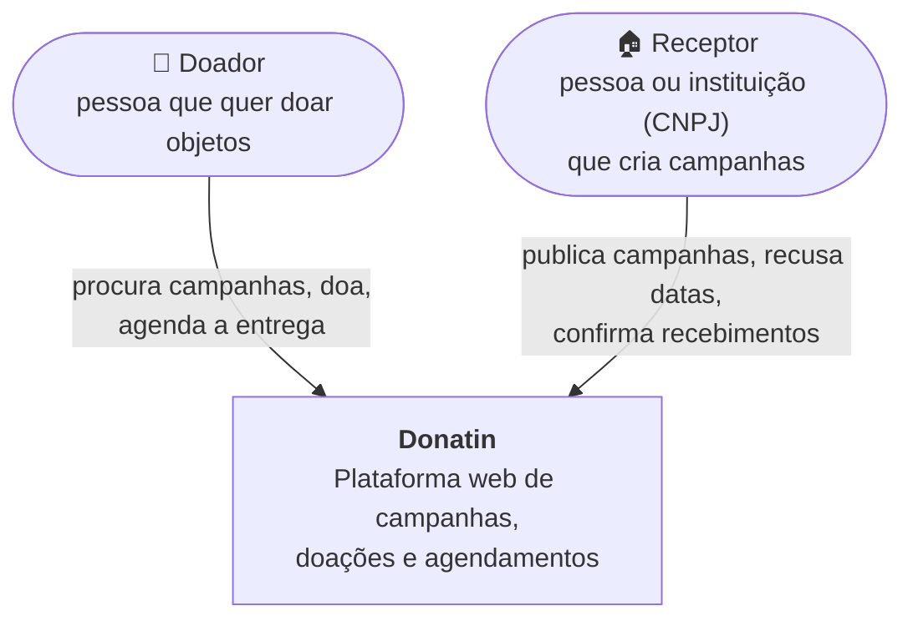
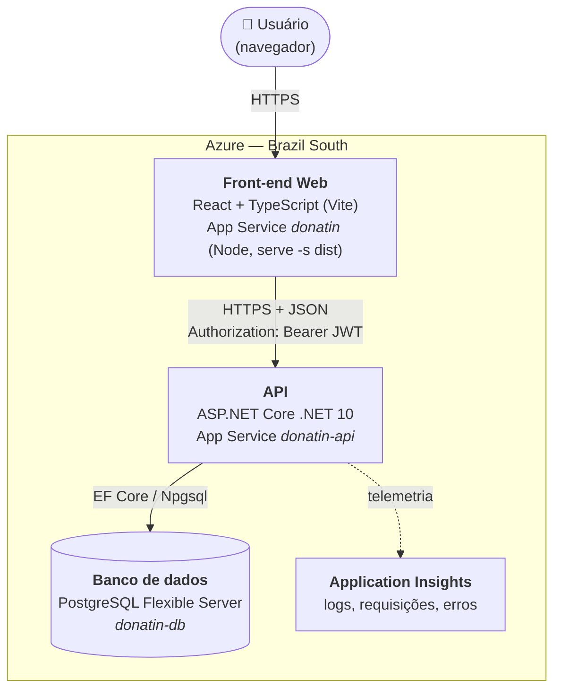
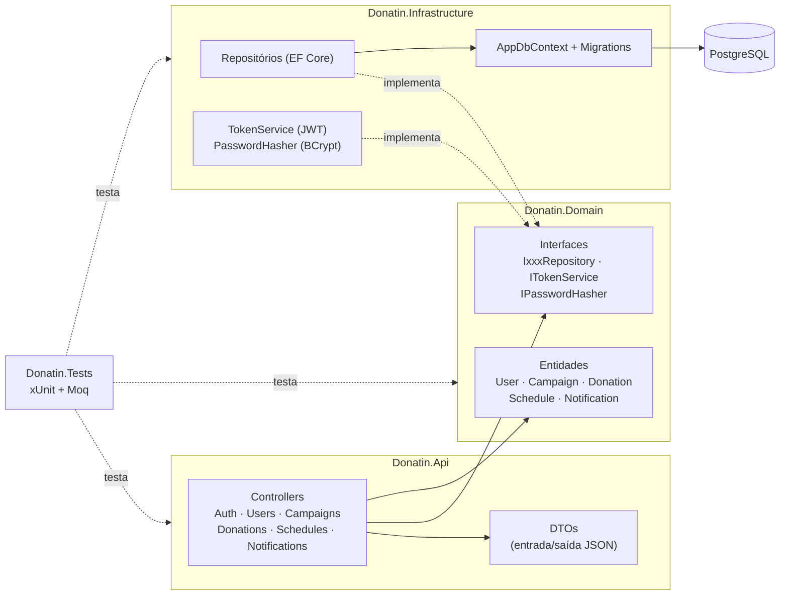
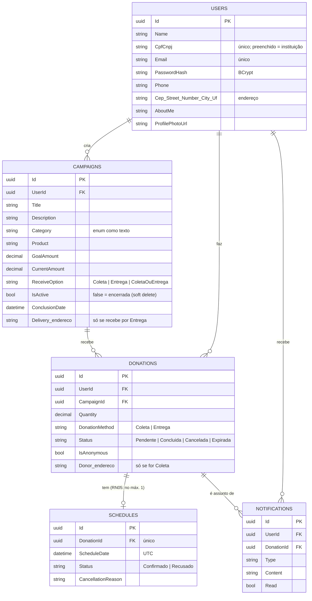

# Arquitetura

O Donatin é uma aplicação **cliente-servidor**: um front-end React (SPA) conversa por HTTP/JSON com uma API ASP.NET Core, que persiste os dados em PostgreSQL. A API segue uma **arquitetura em camadas** inspirada em Clean Architecture, com **modelo de domínio rico** (as regras de negócio ficam dentro das entidades).

## C4 — Nível 1: Contexto

Quem usa o sistema e com o que ele conversa.



O sistema não depende de serviços externos de terceiros: autenticação, notificações e persistência são próprios (ver os desvios em relação ao RFC em [Decisões Técnicas](Decisoes-Tecnicas)).

> Uma mesma conta pode ser doadora e receptora: qualquer usuário autenticado pode criar campanhas (ver [Decisões Técnicas](Decisoes-Tecnicas)).

## C4 — Nível 2: Containers



| Container | Responsabilidade |
|---|---|
| Front-end Web | Telas, validação de formulários (Zod), guarda o JWT no `localStorage` e chama a API pela função `api()` |
| API | Autenticação, regras de negócio, autorização (quem pode o quê), notificações |
| PostgreSQL | Usuários, campanhas, doações, agendamentos e notificações |
| Application Insights | Monitoramento da API em produção (ver [Monitoramento](Monitoramento)) |

## C4 — Nível 3: Componentes da API

A solução `api/Donatin.sln` tem 4 projetos:



| Projeto | O que tem | Depende de |
|---|---|---|
| `Donatin.Domain` | Entidades com as regras (ex.: `Donation.ConfirmDonation()`), enums e **interfaces** dos repositórios/serviços | nada (núcleo) |
| `Donatin.Infrastructure` | `AppDbContext`, migrations, repositórios, `TokenService`, `PasswordHasher` | Domain |
| `Donatin.Api` | Controllers, DTOs, validações, `Program.cs` (injeção de dependência, JWT, CORS) | Domain + Infrastructure |
| `Donatin.Tests` | Testes unitários e de repositório | todos |

**Por que as interfaces ficam no Domain?** Os controllers dependem de `ICampaignRepository`, não de `CampaignRepository`. Em produção o `Program.cs` liga a interface à implementação real (`AddScoped<ICampaignRepository, CampaignRepository>()`); nos testes, o Moq entrega uma versão falsa. Isso é **inversão de dependência**.

### Caminho de uma requisição

```
Navegador → Controller (valida o usuário do JWT e as permissões)
          → Repositório (busca no banco)
          → Entidade (aplica a regra de negócio, ex.: campaign.AddDonation)
          → Repositório.SaveChangesAsync() (grava)
          → DTO (monta o JSON de resposta)
```

## Front-end

```
web/src/
├── App.tsx              # rotas (públicas, de visitante e protegidas)
├── auth/AuthContext.tsx # sessão: login, cadastro, logout, usuário logado
├── lib/api.ts           # função api(): fetch + JWT + tratamento de erros
├── lib/                 # hooks (useFetch, useCampaigns) e regras (donationRules)
├── components/          # layout, cards, sininho de notificações, ProtectedRoute
├── pages/               # uma página por tela
└── types.ts             # tipos TypeScript dos dados da API
```

- **Rotas protegidas:** `ProtectedRoute` manda para `/login` quem não está logado; `GuestRoute` impede quem já está logado de abrir login/cadastro.
- **Sessão:** ao abrir o site, se há token salvo, o `AuthContext` chama `GET /users/me`; se falhar (token expirado), o token é apagado.

## Modelo de dados



Regras de banco configuradas no [`AppDbContext`](../blob/main/api/Donatin.Infrastructure/Data/AppDbContext.cs):

- E-mail e CPF/CNPJ **únicos** (RN10).
- Um agendamento por doação: índice **único** em `Schedules.DonationId` (RN05).
- Enums gravados como **texto** (`HasConversion<string>()`), legíveis direto no banco.
- `DeleteBehavior.Restrict` entre usuários, campanhas e doações: nada é apagado em cascata, para preservar o histórico. Notificações, sim, são apagadas junto com o usuário (`Cascade`).
