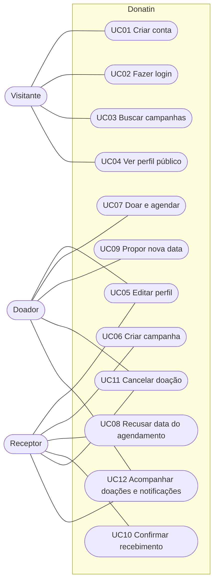

# Casos de Uso

## Atores

| Ator | Quem é |
|---|---|
| **Visitante** | Qualquer pessoa sem login: navega pelas campanhas e perfis públicos |
| **Doador** | Usuário logado que doa para campanhas de outras pessoas |
| **Receptor** | Usuário logado (pessoa ou instituição com CNPJ) dono de uma campanha |

A mesma conta pode ser Doador e Receptor ao mesmo tempo.

## Diagrama

## Descrição

### UC01 — Criar conta (RF01, RF12)
- **Ator:** Visitante
- **Fluxo principal:** preenche nome (ou razão social), e-mail, senha, telefone, endereço e, se for instituição, o CNPJ → a conta é criada e o usuário já entra logado.
- **Alternativos:** e-mail ou CNPJ já cadastrados → mensagem "Este e-mail já está cadastrado." (409). Campos inválidos → mensagem no próprio campo.

### UC02 — Fazer login (RF02)
- **Ator:** Visitante
- **Fluxo principal:** informa e-mail e senha → recebe o token e é levado para a Home, já logado.
- **Alternativo:** credenciais erradas → "Credenciais inválidas." (401), sem dizer se o erro foi no e-mail ou na senha.

### UC03 — Buscar campanhas (RF07, RF08, RN14)
- **Ator:** Visitante, Doador
- **Fluxo principal:** abre Campanhas, filtra por categoria ou digita uma palavra-chave → vê só as campanhas ativas e dentro do prazo. Na Home aparecem as campanhas mais perto da meta.

### UC04 — Ver perfil público (RF13, RF14, RF23)
- **Ator:** Visitante, Doador
- **Fluxo principal:** clica no dono de uma campanha → vê nome, cidade, "sobre mim", campanhas e o botão de ligar (`tel:`).

### UC05 — Editar perfil (RF04)
- **Ator:** Doador, Receptor
- **Fluxo principal:** em Meu perfil, altera os dados → salva.

### UC06 — Criar campanha (RF10, RF11)
- **Ator:** Receptor
- **Pré-condição:** estar logado.
- **Fluxo principal:** informa título, descrição, categoria, produto, meta, prazo e como quer receber (Coleta, Entrega ou os dois). Se recebe por Entrega, informa o endereço de entrega → a campanha é publicada.
- **Alternativos:** prazo no passado, meta ≤ 0 ou endereço incompleto → erro de validação.

### UC07 — Doar e agendar (RF05, RF16, RF17)
- **Ator:** Doador
- **Pré-condição:** campanha ativa, no prazo, sem a meta atingida e de outra pessoa.
- **Fluxo principal:** informa a quantidade, escolhe Coleta ou Entrega (quando a campanha aceita os dois), informa o endereço de retirada (se Coleta) e a data/hora → a doação nasce **Pendente** com o agendamento **Confirmado**, e o receptor é notificado.
- **Alternativos:** própria campanha, campanha encerrada/expirada/com meta atingida, data no passado, anônimo + coleta → 400 com a mensagem do motivo.

### UC08 — Recusar a data do agendamento (RF19, RN08)
- **Ator:** Receptor
- **Fluxo principal:** antes da data prevista, recusa o agendamento informando (opcionalmente) o motivo → o agendamento fica **Recusado** e o doador é notificado para propor outra data.
- **Alternativos:** data já passou, ou já recusado → 400.

### UC09 — Propor nova data (RF16, RN05)
- **Ator:** Doador
- **Fluxo principal:** escolhe uma nova data futura → o **mesmo** agendamento volta a **Confirmado** (nunca há dois agendamentos para a mesma doação) e o receptor é notificado.

### UC10 — Confirmar recebimento (RF20)
- **Ator:** Receptor
- **Fluxo principal:** confirma que recebeu → a doação vira **Concluída**, a quantidade é somada ao arrecadado da campanha e o doador é notificado.
- **Alternativos:** quem não é dono → 403. Doação não pendente → 400.

### UC11 — Cancelar doação (RF09)
- **Ator:** Doador ou Receptor
- **Fluxo principal:** enquanto a doação está **Pendente**, cancela → a doação vira **Cancelada**, o agendamento é recusado e a outra parte é notificada.

### UC12 — Acompanhar doações e notificações (RF18, RF21, RF24, RF25, RF26)
- **Ator:** Doador, Receptor
- **Fluxo principal:** na página Doações vê as doações que fez e as recebidas nas suas campanhas, com status e agendamento. O sininho mostra quantas notificações não lidas existem; abrir uma marca como lida.
