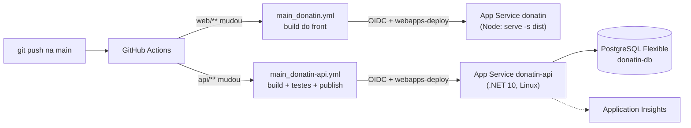

# Deploy e Ambientes

| Ambiente | Front | API | Banco |
|---|---|---|---|
| **Desenvolvimento** (local) | `npm run dev` → http://localhost:5173 | `dotnet run` → http://localhost:5034 (ou Docker → :5080) | PostgreSQL local ou container Docker |
| **Produção** (Azure, Brazil South) | App Service `donatin` | App Service `donatin-api` | PostgreSQL Flexible Server `donatin-db` + Blob Storage (imagens) |

## Produção na Azure



| Recurso | Detalhes |
|---|---|
| App Service Plan | `ASP-Donatin-8be8`, Linux, B1 (compartilhado pelos dois App Services) |
| `donatin` (front) | Node; o build do Vite (`dist/`) é servido pelo comando `npm start` → `serve -s dist -l 8080` (o `-s` faz toda rota cair no `index.html`, necessário para o React Router) |
| `donatin-api` | .NET 10 por código (sem container); Application Insights habilitado |
| `donatin-db` | Azure Database for PostgreSQL – Flexible Server, B1ms, 32 GB, banco `donatin`; firewall liberado só para serviços da Azure |
| Conta de armazenamento | Standard, LRS, contêiner `images` com acesso anônimo **só de leitura de blobs** (qualquer um vê uma imagem pela URL, ninguém lista nem envia); Defender desligado (é pago) |

### Configuração da API (App settings do App Service)

Os segredos ficam nas **variáveis de ambiente** do App Service (Configurações → Variáveis de ambiente), nunca no repositório:

| Variável | Para quê |
|---|---|
| `ConnectionStrings__DonatinDb` | Conexão com o PostgreSQL da Azure |
| `Jwt__Secret` | Chave de assinatura do JWT (mín. 32 caracteres; a API não sobe sem ela) |
| `Cors__AllowedOrigins__0` | URL do front, a única origem que pode chamar a API pelo navegador |
| `Storage__ConnectionString` | Cadeia de conexão da conta de armazenamento (upload de imagens). Sem ela a API sobe normalmente; só o upload falha |

> O `__` (dois sublinhados) é como o .NET lê seções do `appsettings.json` a partir de variáveis de ambiente: `Jwt__Secret` vira `Jwt:Secret`.

Na subida, a API aplica as **migrations** pendentes automaticamente (`db.Database.Migrate()` no `Program.cs`).

### Configuração do front

O endereço da API é embutido no build pela variável `VITE_API_URL`, definida no próprio workflow (`main_donatin.yml`). Sem ela, o front usa `http://localhost:5034/api`.

## Pipelines (GitHub Actions)

| Workflow | Quando roda | O que faz |
|---|---|---|
| [`main_donatin-api.yml`](../blob/main/.github/workflows/main_donatin-api.yml) | push na `main` mudando `api/**` | `dotnet build` → **`dotnet test`** → `dotnet publish` → deploy no `donatin-api`. Se um teste falha, **não há deploy**. |
| [`main_donatin.yml`](../blob/main/.github/workflows/main_donatin.yml) | push na `main` mudando `web/**` | `npm ci --ignore-scripts` → `npm run build` (inclui checagem de tipos `tsc`) → pacote com `dist/` + dependências de produção → deploy no `donatin` |
| [`sonarcloud.yml`](../blob/main/.github/workflows/sonarcloud.yml) | todo **pull request** e push na `main` | testes do front e do back com cobertura + análise do SonarCloud (Quality Gate) |

- **Autenticação na Azure por OIDC:** o GitHub prova sua identidade para a Azure com um token temporário (`azure/login` com `client-id`, `tenant-id`, `subscription-id`). Nenhuma senha da Azure fica salva no repositório.
- **Pipeline protegido contra supply chain:** todas as actions são fixadas pelo **hash do commit** (ex.: `actions/checkout@11d5960... # v4.4.0`), então ninguém consegue trocar o código de uma action por trás de uma tag; e o `npm ci` roda com `--ignore-scripts`, para que pacotes não executem scripts durante a instalação.
- **Fluxo de trabalho:** cada mudança é feita numa branch, vai por pull request (onde o SonarCloud roda) e, ao entrar na `main`, é publicada automaticamente. **Não há deploy manual** por SSH/FTP.
- Também é possível disparar os deploys manualmente pela aba Actions (`workflow_dispatch`).

## Rodando localmente

### Pré-requisitos
- .NET 10 SDK, Node.js 24, e PostgreSQL 15+ **ou** Docker.

### 1. Variáveis de ambiente

```bash
cp .env.example .env          # só para o Docker: DOCKER_POSTGRES_PASSWORD
cp api/.env.example api/.env  # sempre: Jwt__Secret e ConnectionStrings__DonatinDb
```

`api/.env`:
```dotenv
Jwt__Secret=uma_chave_aleatoria_com_pelo_menos_32_caracteres
ConnectionStrings__DonatinDb=Host=localhost;Port=5432;Database=donatin_db;Username=SEU_USUARIO;Password=SUA_SENHA
# opcional: só para testar o upload de imagens
Storage__ConnectionString=cadeia_de_conexao_da_conta_de_armazenamento
```

Para gerar o segredo: `openssl rand -base64 48`. Os dois `.env` estão no `.gitignore`.

### 2. API

**Opção A — Docker** (API + PostgreSQL juntos):
```bash
docker compose up --build
```
API em http://localhost:5080 · banco exposto em `localhost:5433`. Nesse modo o compose sobrescreve a connection string para o container do banco. A imagem da API roda com um usuário **sem privilégios** (`USER $APP_UID`), e não como root.

**Opção B — `dotnet run`** (com PostgreSQL local):
```bash
cd api/Donatin.Api
dotnet run
```
API em http://localhost:5034. As migrations rodam sozinhas na subida.

### 3. Front

```bash
cd web
npm install
npm run dev
```
Front em http://localhost:5173 (origem já liberada no CORS do `appsettings.json`). Se a API estiver no Docker, rode com `VITE_API_URL=http://localhost:5080/api npm run dev`.

### 4. Testes

```bash
dotnet test api/Donatin.sln
```

```bash
cd web && npm test
```

Detalhes de cobertura em [Qualidade e Testes](Qualidade-e-Testes).
