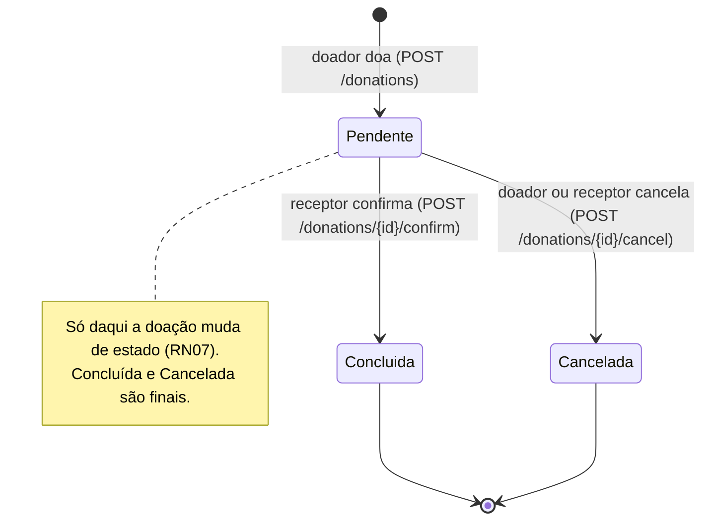
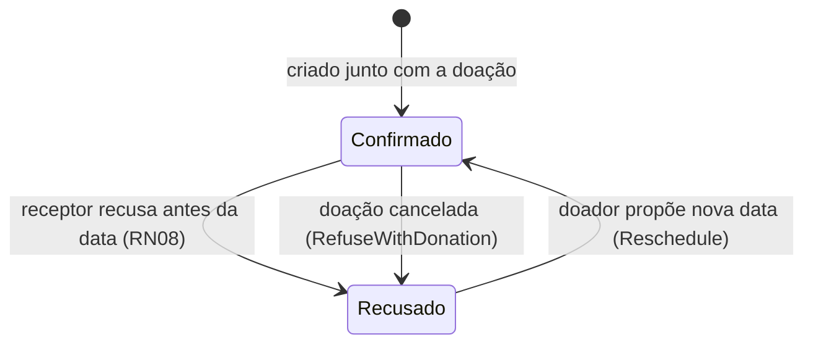
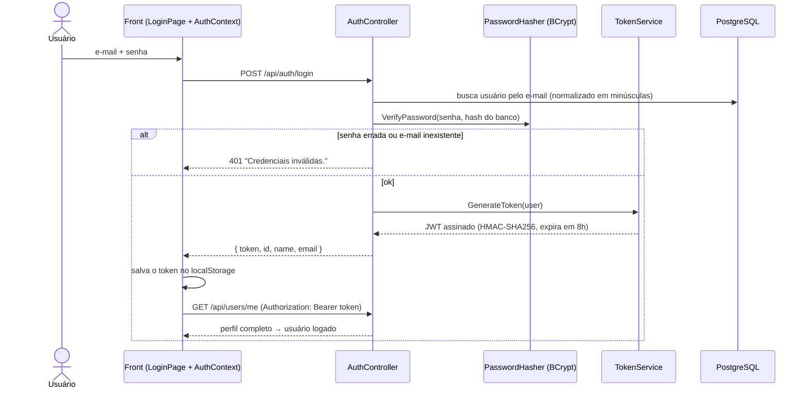
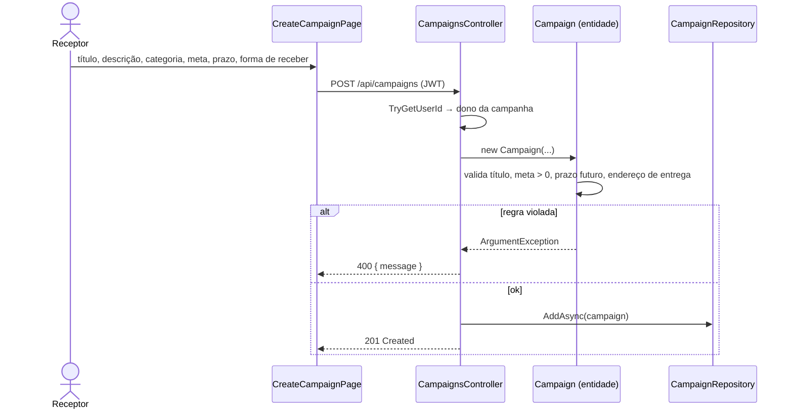
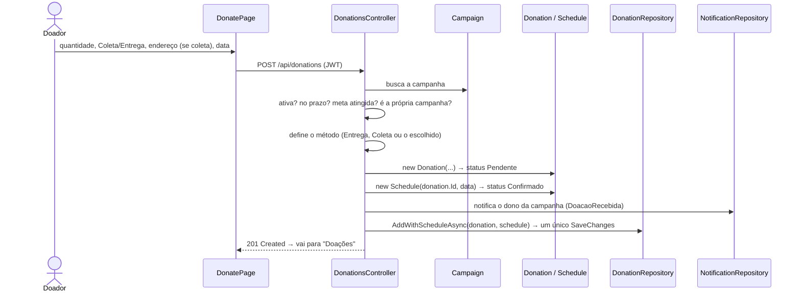
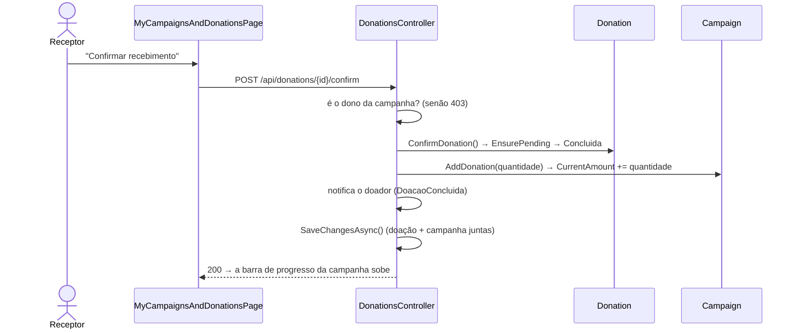

# Fluxos de Negócio

Os fluxos completos do sistema, **da tela até o banco**, com os arquivos envolvidos em cada passo.

Ciclo de vida de uma doação:

Ciclo de vida do agendamento (um por doação, RN05):

---

## Fluxo 1 — Cadastro, login e sessão (JWT)

**Passo a passo no código:**

1. **Tela** — [`LoginPage.tsx`](../blob/main/web/src/pages/LoginPage.tsx) valida o formulário com Zod e chama `login()` do contexto.
2. **Sessão** — [`AuthContext.tsx`](../blob/main/web/src/auth/AuthContext.tsx): `login()` chama a API, e `startSession()` guarda o token (`tokenStorage.set`) e carrega o perfil por `GET /users/me`.
3. **Chamada HTTP** — [`lib/api.ts`](../blob/main/web/src/lib/api.ts): a função `api()` coloca `Authorization: Bearer <token>` em **toda** requisição e transforma erros da API em `ApiError` (com a mensagem e os erros de cada campo).
4. **API** — [`AuthController.cs`](../blob/main/api/Donatin.Api/Controllers/AuthController.cs): `Register` verifica e-mail/CNPJ repetido (409), criptografa a senha com BCrypt e salva; `Login` confere o hash.
5. **Token** — [`TokenService.cs`](../blob/main/api/Donatin.Infrastructure/Services/TokenService.cs): coloca o **id do usuário** na claim `NameIdentifier`.
6. **Validação do token** — [`Program.cs`](../blob/main/api/Donatin.Api/Program.cs): `AddJwtBearer` confere assinatura, emissor, público e validade. Nos controllers, `TryGetUserId` lê o id da claim; é assim que a API sabe **quem** está fazendo cada requisição.
7. **Ao reabrir o site** — o `AuthContext` vê que há token salvo e chama `/users/me`; se o token expirou, ele é apagado e o usuário volta a ser visitante.

> **Segurança:** a senha nunca é guardada, só o hash BCrypt. A mensagem de erro do login é a mesma para e-mail e senha errados, para não revelar quais e-mails existem.

---

## Fluxo 2 — Criar e encontrar uma campanha

- **Regras** — no construtor de [`Campaign.cs`](../blob/main/api/Donatin.Domain/Entities/Campaign.cs): meta maior que zero, prazo no futuro, e endereço de entrega obrigatório **só** quando a campanha recebe por Entrega (se não, o endereço nem é guardado — LGPD).
- **Busca** — `GET /campaigns?category=&keyword=` → `CampaignRepository.SearchActiveAsync` traz só campanhas **ativas e no prazo** (RN14). A Home usa `GET /campaigns/closest-to-goal?limit=3`.
- **Encerrar** — `DELETE /campaigns/{id}` não apaga: chama `campaign.CloseCampaign()` (`IsActive = false`), o chamado **soft delete**, para manter o histórico das doações. Só o dono pode (403).
- **Calculados** — `IsGoalReached` (arrecadado ≥ meta) e `HasExpired` (prazo passou) são propriedades calculadas, não colunas do banco.

---

## Fluxo 3 — Doar e agendar a entrega

**Onde ficam as regras:**

| Regra | Onde |
|---|---|
| Campanha encerrada, expirada ou com meta atingida não recebe doação | `DonationsController.Create` (o front também bloqueia, em [`donationRules.ts`](../blob/main/web/src/lib/donationRules.ts)) |
| Não pode doar para a própria campanha | `DonationsController.Create` |
| Anônimo só na Entrega | `DonationsController.Create` (o front desmarca "anônimo" ao escolher Coleta) |
| Quantidade > 0 e endereço completo na Coleta | construtor de [`Donation.cs`](../blob/main/api/Donatin.Domain/Entities/Donation.cs) |
| Data do agendamento no futuro (RN04) | construtor de [`Schedule.cs`](../blob/main/api/Donatin.Domain/Entities/Schedule.cs) |

**Por que `AddWithScheduleAsync`?** Doação e agendamento são gravados no **mesmo** `SaveChangesAsync`: ou os dois entram no banco, ou nenhum entra (transação). A notificação também: `NotificationRepository.AddAsync` só **adiciona ao contexto** do EF (não salva), então ela é gravada junto, no mesmo `SaveChangesAsync`.

---

## Fluxo 4 — Recusar a data e reagendar

1. **Receptor recusa** — `POST /schedules/{id}/refuse` em [`SchedulesController.cs`](../blob/main/api/Donatin.Api/Controllers/SchedulesController.cs):
   - só o dono da campanha (403) e só com a doação Pendente (400);
   - `schedule.RefuseSchedule(motivo)`: só se estiver Confirmado **e antes da data prevista** (RN08) — senão `InvalidOperationException` → 400;
   - notifica o doador (`ReagendamentoSolicitado`), com o motivo.
2. **Doador propõe nova data** — `POST /schedules`:
   - só quem fez a doação (403);
   - como já existe um agendamento, chama `existing.Reschedule(novaData)`: volta para Confirmado e limpa o motivo. **Não** cria um segundo registro (RN05, garantido também pelo índice único no banco);
   - notifica o receptor (`Reagendado`).

---

## Fluxo 5 — Confirmar o recebimento (ou cancelar)

- **RN07** — `Donation.EnsurePending()` impede mexer numa doação que não está Pendente (confirmar duas vezes, cancelar uma concluída…).
- **Campanha já encerrada?** O recebimento ainda pode ser confirmado: a doação foi feita dentro do prazo. Quem bloqueia **novas** doações é o `POST /donations`.
- **Cancelar** — `POST /donations/{id}/cancel`: doador **ou** receptor, só se Pendente. Também recusa o agendamento (`RefuseWithDonation`) e notifica **a outra parte** ("O doador cancelou…" / "O dono da campanha cancelou…").

---

## Notificações (RN15)

Todo controller que muda o estado de uma doação chama um `Notify(destinatário, remetente, ...)`. Se o destinatário é a própria pessoa que fez a ação, nada é enviado. No front, o [`NotificationBell.tsx`](../blob/main/web/src/components/NotificationBell.tsx) busca `GET /notifications/unread-count` para o número no sininho, lista `GET /notifications/mine` e marca como lida com `POST /notifications/{id}/read` (ou `read-all`).

| Evento | Quem recebe | Tipo |
|---|---|---|
| Nova doação | Receptor | `DoacaoRecebida` |
| Receptor recusou a data | Doador | `ReagendamentoSolicitado` |
| Doador escolheu nova data | Receptor | `Reagendado` |
| Recebimento confirmado | Doador | `DoacaoConcluida` |
| Doação cancelada | A outra parte | `DoacaoCancelada` |

---

## Tabela de endpoints

| Método | Rota | Auth | O que faz |
|---|---|---|---|
| POST | `/api/auth/register` | — | Cria conta e devolve o JWT |
| POST | `/api/auth/login` | — | Autentica e devolve o JWT |
| GET | `/api/users/me` | ✔ | Meu perfil |
| PUT | `/api/users/me` | ✔ | Edita meu perfil |
| GET | `/api/users/{id}/public` | — | Perfil público |
| GET | `/api/campaigns` | — | Campanhas ativas (`?category=&keyword=`) |
| GET | `/api/campaigns/closest-to-goal` | — | Mais perto da meta (Home) |
| GET | `/api/campaigns/{id}` | — | Detalhe |
| GET | `/api/campaigns/user/{userId}` | — | Campanhas de um usuário |
| POST | `/api/campaigns` | ✔ | Cria campanha |
| PUT | `/api/campaigns/{id}` | ✔ dono | Atualiza campanha |
| DELETE | `/api/campaigns/{id}` | ✔ dono | Encerra (soft delete) |
| POST | `/api/donations` | ✔ | Doa + agenda |
| GET | `/api/donations/mine` | ✔ | Minhas doações |
| GET | `/api/donations/campaign/{id}` | ✔ dono | Doações recebidas por uma campanha |
| GET | `/api/donations/{id}` | ✔ doador ou dono | Detalhe |
| POST | `/api/donations/{id}/confirm` | ✔ dono | Confirma recebimento |
| POST | `/api/donations/{id}/cancel` | ✔ doador ou dono | Cancela |
| GET | `/api/schedules/mine` | ✔ | Meus agendamentos (como doador ou dono) |
| GET | `/api/schedules/donation/{id}` | ✔ | Agendamento de uma doação |
| POST | `/api/schedules` | ✔ doador | Propõe (nova) data |
| POST | `/api/schedules/{id}/refuse` | ✔ dono | Recusa a data |
| GET | `/api/notifications/mine` | ✔ | Minhas notificações |
| GET | `/api/notifications/unread-count` | ✔ | Quantidade não lida |
| POST | `/api/notifications/{id}/read` | ✔ | Marca uma como lida |
| POST | `/api/notifications/read-all` | ✔ | Marca todas como lidas |

**Códigos de resposta usados:** 200 OK · 201 Created · 204 No Content · 400 regra de negócio violada · 401 sem login · 403 logado mas sem permissão · 404 não encontrado · 409 conflito (e-mail/CNPJ repetido).
