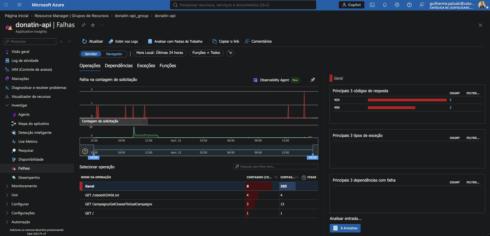
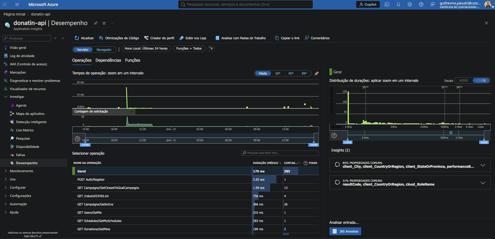
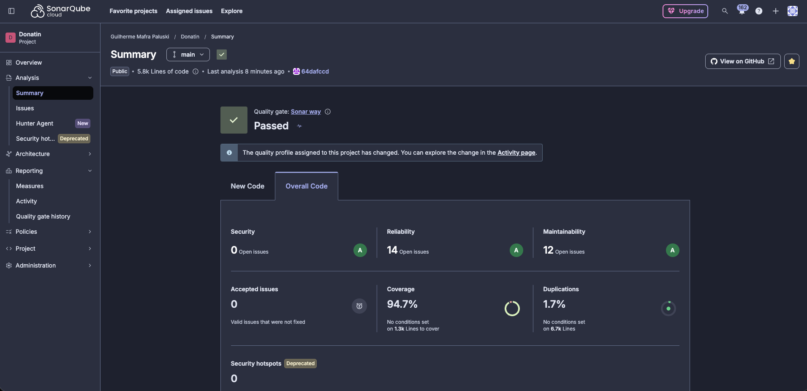

# Monitoramento

A API em produção é monitorada pelo **Azure Application Insights**, habilitado no App Service `donatin-api` (Monitoramento → Application Insights). A instrumentação é **automática** (sem código na aplicação): o agente da Azure coleta os dados do ASP.NET Core em execução.

## O que é coletado

| Dado | Para quê |
|---|---|
| **Requisições** (rota, status, duração) | Ver os endpoints mais usados e os mais lentos (RNF02: resposta < 2 s) |
| **Falhas** (respostas 5xx e exceções com stack trace) | Descobrir erros em produção antes de o usuário reclamar |
| **Dependências** (chamadas ao PostgreSQL) | Ver se a lentidão está na API ou no banco |
| **Logs** (`ILogger`) | Investigar um problema específico |
| **Live Metrics** | Acompanhar a API em tempo real (RNF08) |

## Onde olhar (portal da Azure → Application Insights do `donatin-api`)

| Tela | O que mostra |
|---|---|
| **Visão geral** | Gráficos de requisições, tempo de resposta e falhas |
| **Live Metrics** | Requisições e erros acontecendo agora |
| **Falhas** | Erros agrupados por endpoint e por exceção, com o detalhe de cada ocorrência |
| **Desempenho** | Tempo médio e percentis por endpoint |
| **Logs** | Consultas em KQL (exemplos abaixo) |

### Consultas úteis (KQL)

Erros nas últimas 24 horas, por endpoint:
```kusto
requests
| where timestamp > ago(24h) and success == false
| summarize falhas = count() by name, resultCode
| order by falhas desc
```

Endpoints mais lentos:
```kusto
requests
| where timestamp > ago(7d)
| summarize media_ms = avg(duration), p95_ms = percentile(duration, 95), total = count() by name
| order by p95_ms desc
```

## Outras fontes

- **Log stream do App Service** (`donatin-api` → Monitoramento → Fluxo de log): saída do console da API em tempo real, útil logo depois de um deploy.
- **GitHub Actions:** histórico de cada build, teste e deploy.
- **SonarCloud:** qualidade do código a cada pull request.

> **Teste de disponibilidade:** não foi configurado. O teste "Standard" do Application Insights é cobrado por execução (US$ 0,001 cada, ~US$ 26–43/mês a cada 5 minutos em vários locais), o que consumiria os créditos da assinatura Azure for Students. A disponibilidade é acompanhada pelas requisições reais e pelo Live Metrics.

## Prints

### Application Insights — Falhas (últimas 24 horas)


8 falhas em 385 requisições, nenhuma causada pelo código da aplicação:
- **404 em `/robots933456.txt`** (4): verificação automática que a própria Azure faz para saber se o App Service está de pé.
- **404 em `GET /`** (1): acesso à raiz da API, que não tem rota (os endpoints começam em `/api`).
- **499 em `closest-to-goal`** (3): o navegador fechou a conexão antes da resposta (usuário mudou de página ou a API estava "acordando").
- **Exceções: nenhuma.**

### Application Insights — Desempenho (últimas 24 horas)


Tempo médio de **179 ms** por requisição. Os mais lentos são:
- **`POST Auth/Register` (2,65 s):** o BCrypt é lento de propósito, para dificultar ataques de força bruta à senha.
- **`GET closest-to-goal` (1,99 s):** é a primeira chamada da Home, que muitas vezes pega a API em *cold start* (o App Service "dorme" sem uso e demora a acordar).

### SonarCloud


Ver detalhes em [Qualidade e Testes](Qualidade-e-Testes#análise-estática--sonarcloud).