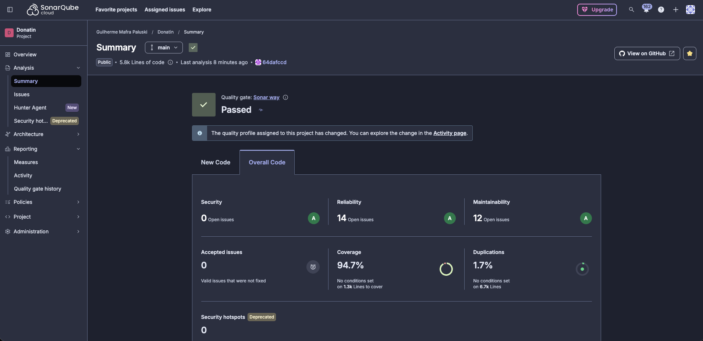

# Qualidade e Testes

## Resumo

| | Back-end (.NET) | Front-end (React) | Meta do Playbook |
|---|---|---|---|
| Testes | 178 | 189 | — |
| Cobertura de linhas | **96,2%** | **98,4%** | 75% back · 25% front |
| Ferramentas | xUnit, Moq, coverlet, EF Core InMemory | Vitest, Testing Library, user-event, jsdom | |

*Medido em 22/11/2026 com os relatórios locais (coverlet e Vitest), separados por lado — é assim que a meta do Playbook é definida (75% back / 25% front).*

> **Por que o SonarCloud mostra 94,7%?** O Sonar junta back e front num número só e calcula a partir das linhas que ele considera "cobríveis" nos dois relatórios. Os números acima são os de cada lado, separados. Os dois estão bem acima das metas.

Cobertura do back por projeto: `Donatin.Api` 100% · `Donatin.Domain` 98,4% · `Donatin.Infrastructure` 84,9%.

**O que fica fora da conta (de propósito):** migrations (código gerado pelo EF), `Program.cs` (só configuração) e `AppDbContextFactory.cs` (usado só pela ferramenta de migrations) no back; `main.tsx`, `types.ts` e os próprios arquivos de teste no front. A configuração está em [`api/coverage.runsettings`](../blob/main/api/coverage.runsettings) e [`web/vitest.config.ts`](../blob/main/web/vitest.config.ts).

## Como gerar a cobertura

Back-end:
```bash
cd api
dotnet test Donatin.Tests --settings coverage.runsettings --results-directory TestResults
```
O relatório sai em `TestResults/<id>/coverage.cobertura.xml`. Para ver em HTML: `dotnet tool install -g dotnet-reportgenerator-globaltool` e `reportgenerator -reports:TestResults/*/coverage.cobertura.xml -targetdir:TestResults/html`.

Front-end:
```bash
cd web
npm run coverage
```
A tabela aparece no terminal (coluna `% Lines`), e o relatório HTML fica em `web/coverage/index.html`.

## Como os testes estão organizados

### Back-end — `api/Donatin.Tests/`

| Pasta | O que testa | Como |
|---|---|---|
| `Domain/` | Regras das entidades (`Campaign`, `Donation`, `Schedule`, `User`, `Notification`) | Cria a entidade e chama o método; não precisa de banco |
| `Controllers/` | Cada endpoint: sucesso, 400, 401, 403, 404, notificações | Repositórios falsos com **Moq** (`Setup` diz o que devolver, `Verify` confere o que foi chamado) e usuário logado simulado com `TestData.LoginAs` |
| `Infrastructure/` | Configuração do banco (índices únicos, enums como texto, delete behaviors) e consultas de repositório | Modelo do EF montado sem conexão; repositórios com **EF Core InMemory** |
| `Validation/` | Validação de URL opcional dos DTOs | |
| `Helpers/TestData.cs` | Fábricas de dados de teste (`Campaign()`, `Donation()`, `User()`…) e `SetPrivate` para simular estados (ex.: data no passado) | |

Exemplo (padrão **Arrange → Act → Assert**):

```csharp
[Fact]
public async Task Create_CampanhaQueJaAtingiuAMeta_RetornaBadRequest()
{
  // Arrange: campanha com a meta batida, devolvida pelo repositório falso
  var campaign = TestData.Campaign(_ownerId, ReceiveOption.Entrega, goal: 5);
  campaign.AddDonation(5);
  _campaigns.Setup(r => r.GetCampaignByIdAsync(campaign.Id)).ReturnsAsync(campaign);

  // Act: outro usuário tenta doar
  var result = await ControllerLoggedAs(_donorId).Create(Dto(campaign.Id));

  // Assert: 400 e nada foi salvo
  Assert.IsType<BadRequestObjectResult>(result.Result);
  _donations.Verify(r => r.AddWithScheduleAsync(It.IsAny<Donation>(), It.IsAny<Schedule>()), Times.Never);
}
```

### Front-end — `web/src/**/__tests__/`

Cada pasta tem uma subpasta `__tests__` ao lado do código que testa (`pages/__tests__`, `components/__tests__`, `lib/__tests__`, `auth/__tests__`).

- **A API é simulada:** `vi.mock('../lib/api')` troca a função `api()` por uma falsa, e o helper [`routeApi`](../blob/main/web/src/test/apiMock.ts) define a resposta de cada rota (`'GET /campaigns': [...]`).
- **O usuário é simulado:** `@testing-library/user-event` digita e clica como uma pessoa; as buscas são feitas pelo que o usuário vê (`getByRole('button', { name: 'Entrar' })`, `getByLabelText('E-mail')`).
- **Dados de teste:** [`src/test/factories.ts`](../blob/main/web/src/test/factories.ts) (`makeCampaign`, `makeDonation`…).

## TDD

Os ciclos de TDD aparecem no histórico de commits: primeiro um commit `test:` com o teste **falhando** (vermelho), depois um commit `fix:` com a correção que faz ele passar (verde).

| # | Comportamento | 🔴 Teste falhando | 🟢 Correção |
|---|---|---|---|
| 1 | Recusar agendamento depois da data deve dar 400 (e não erro 500) — RN08 | [`f795c15`](../commit/f795c15) | [`cc0d384`](../commit/cc0d384) |
| 2 | Confirmar recebimento depois que a campanha expirou/encerrou deve funcionar | [`092eb25`](../commit/092eb25) | [`6d64e40`](../commit/6d64e40) |
| 3 | Doar para campanha com a meta atingida deve dar 400 (o back passa a seguir a regra do front) | [`57136f0`](../commit/57136f0) | [`e12c044`](../commit/e12c044) |
| 4 | Campanhas de um usuário devem trazer o dono (`Include(User)` faltando) | [`d1f1e08`](../commit/d1f1e08) | [`f6d2b72`](../commit/f6d2b72) |
| 5 | Links do rodapé devem levar a páginas que existem (front) | [`0d5b09d`](../commit/0d5b09d) | [`a66d7c8`](../commit/a66d7c8) |

Ciclo 1 em detalhe:
1. **Vermelho:** o teste `RefuseSchedule_DepoisDaDataPrevista_LancaInvalidOperationException` esperava uma `InvalidOperationException`, mas o domínio lançava `InvalidCastException`, que o controller não tratava. O resultado era um **erro 500** em vez de uma mensagem para o usuário.
2. **Verde:** trocar o tipo da exceção em `Schedule.RefuseSchedule`; o controller já transformava `InvalidOperationException` em **400** com a mensagem.
3. Os outros 170+ testes continuaram passando, o que garante que a correção não quebrou nada.

## Análise estática — SonarCloud

- Projeto: [guilhermepaluski_Donatin](https://sonarcloud.io/project/overview?id=guilhermepaluski_Donatin).
- Roda pelo workflow [`sonarcloud.yml`](../blob/main/.github/workflows/sonarcloud.yml) em **todo pull request** e em cada push na `main`: executa os testes dos dois lados, envia a cobertura (`opencover` do .NET e `lcov` do Vitest) e analisa bugs, vulnerabilidades, code smells e duplicação.
- **Quality Gate:** o PR mostra se o código novo passou nos critérios (cobertura ≥ 80%, duplicação ≤ 3% e nota A em segurança, confiabilidade e manutenibilidade do código novo).
- **Situação atual (`main`):** Quality Gate **Passed**, nota **A** em segurança, confiabilidade e manutenibilidade, **0 vulnerabilidades**, cobertura de 94,7% e 1,7% de duplicação.

### Issues corrigidas a partir do Sonar

O Sonar apontou 10 vulnerabilidades e 5 bugs no código geral. Todas foram tratadas no PR `chore/sonar-issues`:

| Regra | Problema | Correção |
|---|---|---|
| S7637 | Actions referenciadas por tag (`@v4`), que pode ser movida | Actions fixadas pelo hash completo do commit |
| S6505 | `npm ci` sem `--ignore-scripts` no deploy do front | Adicionado `--ignore-scripts` |
| S6444 | Regex do CEP sem timeout (risco de ReDoS) | `Regex.IsMatch(..., TimeSpan.FromMilliseconds(100))` em `Campaign` e `Donation` |
| S6471 | Imagem Docker rodando como root | `USER $APP_UID` no `Dockerfile` |
| S9383 | Promise de `navigate()` sem `await` | `void navigate(...)` (ignorada de propósito) |
| S6781 | "Segredo do JWT exposto" no `TokenService` | **Falso positivo:** o segredo vem da variável de ambiente `Jwt__Secret` (App Settings da Azure / `.env` fora do git). O valor que chegou a ser commitado no início do projeto foi removido e não é o usado em produção. |

As issues de confiabilidade e manutenibilidade que restam são de severidade baixa (por isso as notas continuam A).



## Outras verificações

| Ferramenta | Onde |
|---|---|
| ESLint | `npm run lint` no front |
| TypeScript (`tsc -b`) | roda no `npm run build`; o deploy do front falha se houver erro de tipo |
| `dotnet test` | roda no pipeline da API; o deploy não acontece se algum teste falhar |
